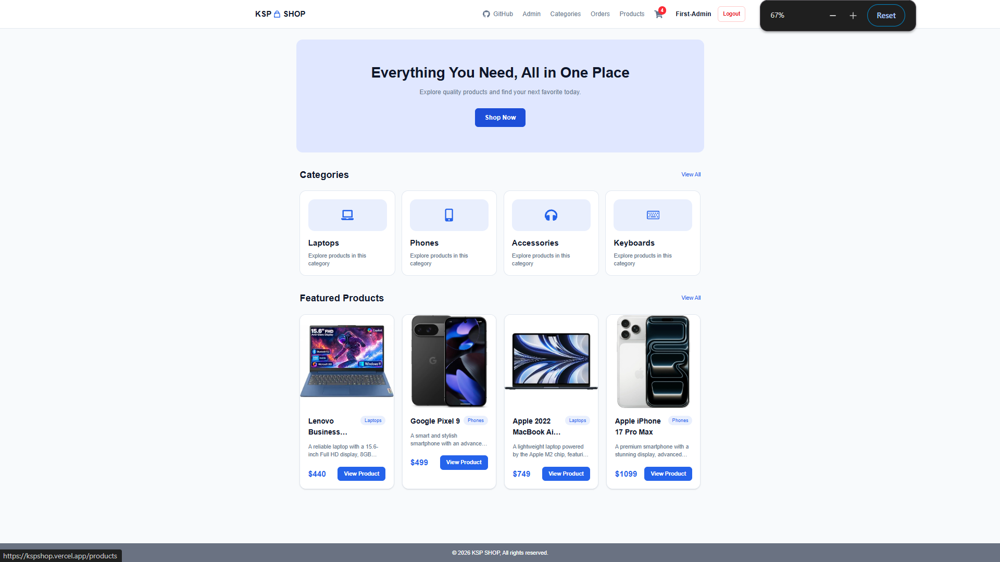
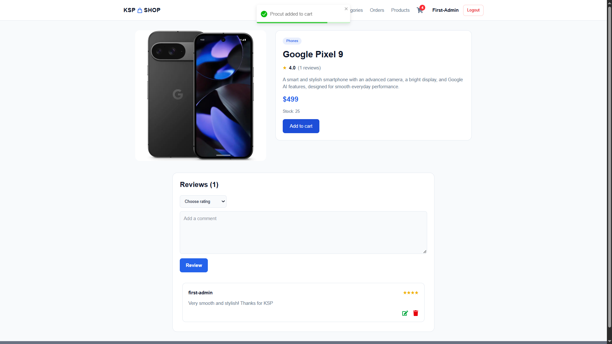
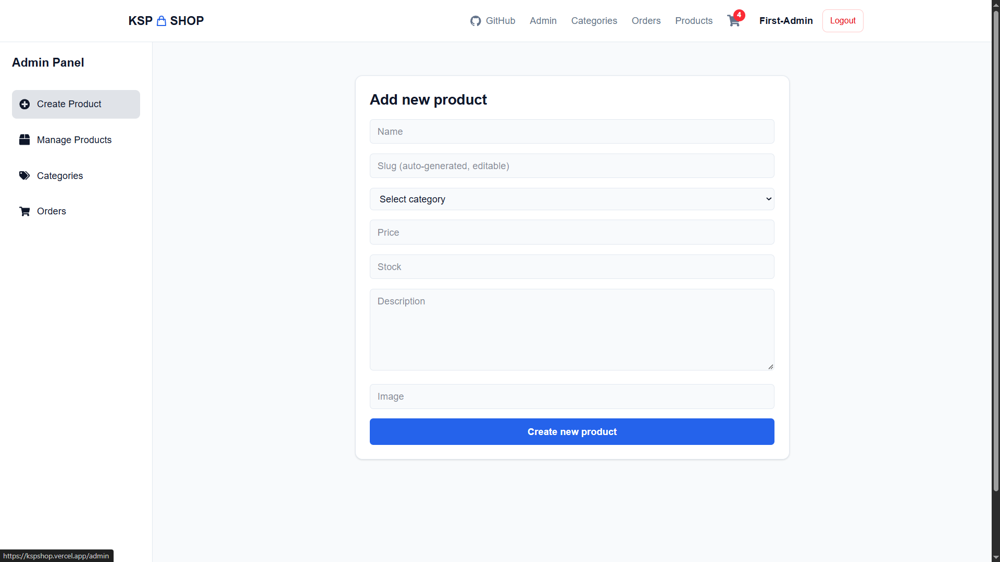
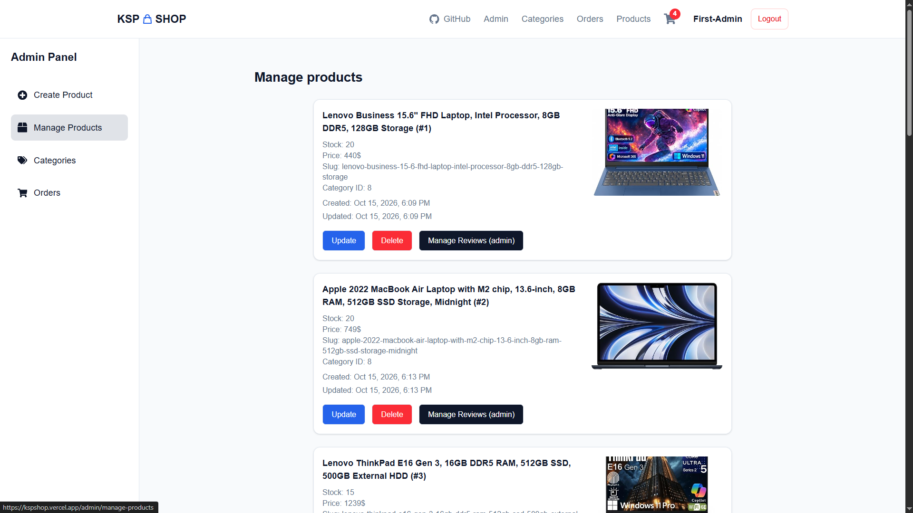

# KSP Shop — Full-Stack E-commerce

A full-stack e-commerce platform built with Next.js, TypeScript, Prisma, and PostgreSQL, featuring customer shopping functionality and an admin dashboard.

## Features

- User registration, login, and secure authentication
- Product and category management
- Product details and customer reviews
- Shopping cart and checkout
- Order creation and tracking
- Admin dashboard for managing products, categories, and orders
- Role-based authorization and protected routes
- Input validation using Zod
- Password hashing and JWT authentication
- Transaction-based order processing and stock management
- Responsive user interface

## Screenshots

### Home Page



### Single Product Page



### Admin — Create Product



### Admin — Manage Products



## Tech Stack

- **Framework:** Next.js
- **Language:** TypeScript
- **Styling:** Tailwind CSS
- **Database:** PostgreSQL
- **ORM:** Prisma
- **Validation:** Zod
- **Authentication:** JWT, cookies, and password hashing

## Getting Started

### Prerequisites

- Node.js
- PostgreSQL
- npm

### Installation

1. Clone the repository.
2. Install dependencies:

   ```bash
   npm install
   ```

3. Configure the required environment variables in a local `.env` file according to the project's configuration.
4. Complete the database setup using the project's Prisma configuration.
5. Start the development server:

   ```bash
   npm run dev
   ```

6. Open [http://localhost:3000](http://localhost:3000).

## Security

The application includes server-side authorization, input validation, protected resources, and safeguards for order processing.

## Author

GitHub: https://github.com/code-ofwar

## Known Issues

### 1. Prisma Version Compatibility

The project currently uses a Prisma release-candidate version, which may cause compatibility issues.

**Temporary workaround:** The `migrations` directory is excluded from TypeScript checks in `tsconfig.json`:

```json
"exclude": ["node_modules", "migrations"]
```

This workaround is temporary and should be reviewed after upgrading to a compatible Prisma version.

### 2. Concurrent Stock Updates

The current order creation logic does not fully prevent race conditions when multiple orders attempt to purchase the same product simultaneously. This may result in incorrect stock levels or overselling.

**Planned improvement:** Implement concurrency-safe stock updates using atomic conditional database updates or appropriate database locking and transaction isolation.
